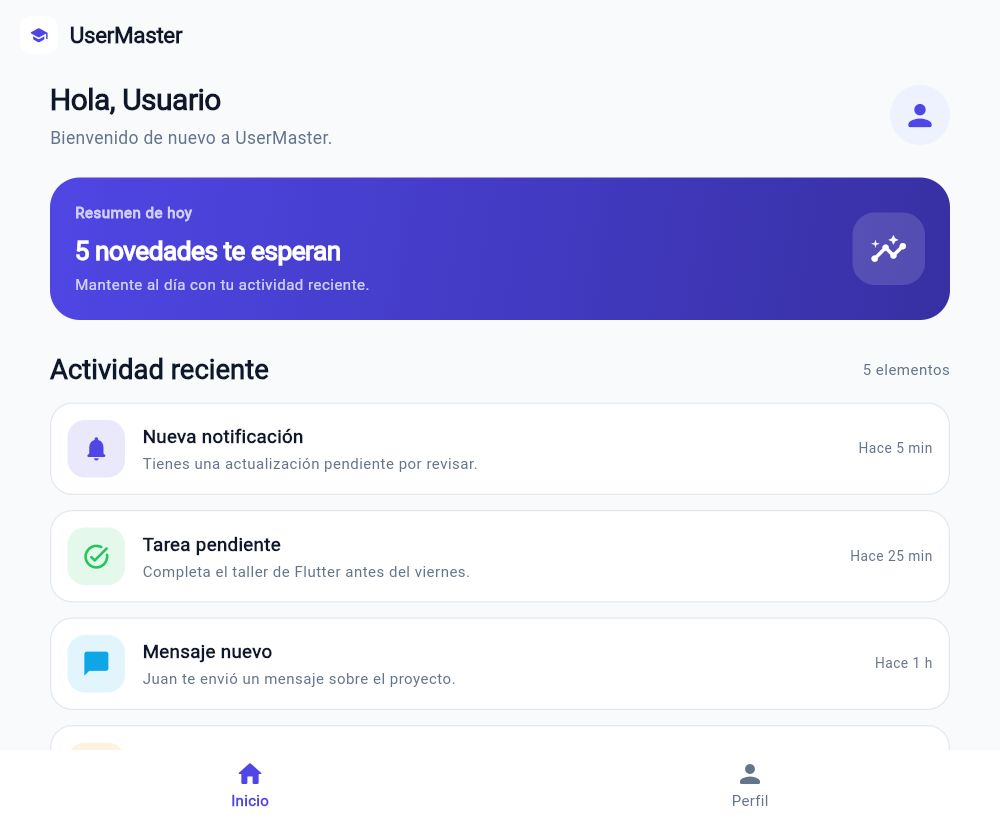
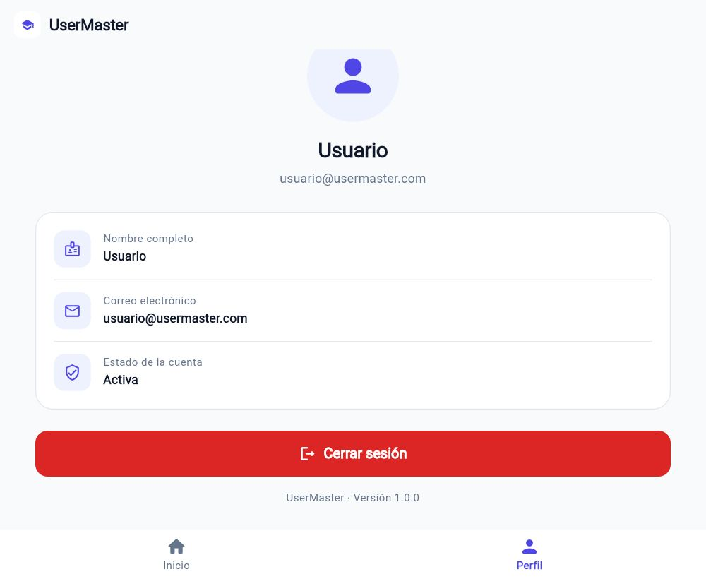

# UserMaster

Aplicación base desarrollada en Flutter con **Clean Architecture**, autenticación simulada y un dashboard sencillo. Proyecto académico del Taller 2.

[](https://flutter.dev)
[](https://dart.dev)
[](https://juanesb0315.github.io/flutter_2/)

## Descripción

UserMaster es una aplicación Flutter que implementa un flujo completo de autenticación simulado: splash screen, inicio de sesión, registro, recuperación de contraseña, dashboard con actividad reciente y perfil de usuario. La navegación está centralizada, los componentes visuales son reutilizables y la lógica está separada por capas siguiendo los principios de Clean Architecture.

La aplicación no consume un backend real: la autenticación se simula mediante un repositorio en memoria con retardos controlados de 3, 2, 1.2 y 0.8 segundos para representar las cargas de red.

## Objetivos

- Construir una aplicación Flutter funcional con las pantallas y flujos solicitados.
- Aplicar una estructura base de Clean Architecture (`domain`, `data`, `presentation`).
- Reutilizar widgets comunes en lugar de duplicar código.
- Centralizar la navegación y la paleta de colores.
- Automatizar el análisis, las pruebas y el despliegue web con GitHub Actions.
- Publicar la aplicación en GitHub Pages.

## Funcionalidades

- **Splash Screen:** logo centrado sobre el color principal y redirección automática al login después de 3 segundos.
- **Inicio de sesión:** validación de correo y contraseña, indicador de carga de 2 segundos y navegación al dashboard.
- **Registro:** nombre completo, correo, contraseña y confirmación; validación de coincidencia y retorno al login.
- **Recuperar contraseña:** validación del correo y `SnackBar` de confirmación.
- **Dashboard:** mensaje de bienvenida, resumen y cinco tarjetas de actividad reciente.
- **Perfil:** avatar genérico, nombre, correo, estado de la cuenta y cierre de sesión.
- **Cierre de sesión:** destruye todo el historial de navegación y regresa al login.

> Para probar el login se puede usar cualquier correo con formato válido y una contraseña de mínimo 6 caracteres. Si primero se registra un usuario, su nombre se conserva en memoria para el perfil durante la sesión.

## Capturas

| Inicio de sesión | Registro |
| --- | --- |
|  |  |

| Dashboard | Perfil |
| --- | --- |
|  |  |

| Recuperar contraseña |
| --- |
|  |

## Tech Stack

- **Flutter 3.47.8** y **Dart 3.13.7**
- **Material 3**
- Navegación nativa con rutas nombradas
- Repositorio mock con `Future.delayed`
- `flutter_lints` para análisis estático
- `flutter_test` para pruebas de widgets
- **GitHub Actions + GitHub Pages** para CI/CD

No se utilizan paquetes externos de estado ni de navegación: la aplicación se apoya en las APIs nativas de Flutter.

## Estructura del proyecto

```text
lib/
├── main.dart
├── app.dart
├── core/
│   ├── di/
│   │   └── app_dependencies.dart
│   ├── session/
│   │   └── session_manager.dart
│   └── validators/
│       └── app_validators.dart
├── routes/
│   └── app_routes.dart
├── theme/
│   ├── app_colors.dart
│   └── app_theme.dart
├── widgets/
│   ├── app_button.dart
│   ├── app_logo.dart
│   ├── app_text_field.dart
│   └── auth_scaffold.dart
└── features/
    ├── splash/
    │   └── presentation/pages/splash_page.dart
    ├── auth/
    │   ├── domain/
    │   │   ├── entities/user.dart
    │   │   └── repositories/auth_repository.dart
    │   ├── data/
    │   │   └── repositories/mock_auth_repository.dart
    │   └── presentation/pages/
    │       ├── login_page.dart
    │       ├── register_page.dart
    │       └── forgot_password_page.dart
    ├── dashboard/
    │   └── presentation/
    │       ├── pages/dashboard_page.dart
    │       └── widgets/
    │           ├── home_tab.dart
    │           └── recent_item_card.dart
    └── profile/
        └── presentation/pages/profile_page.dart
```

### Capas de Clean Architecture

- **Domain:** entidad `User` y contrato `AuthRepository`.
- **Data:** implementación `MockAuthRepository` con los tiempos de carga simulados.
- **Presentation:** páginas, widgets, tema y navegación.

## Rutas

| Ruta | Pantalla |
| --- | --- |
| `/` | Splash |
| `/login` | Inicio de sesión |
| `/register` | Registro |
| `/forgot-password` | Recuperación de contraseña |
| `/dashboard` | Dashboard con pestañas Inicio y Perfil |

Las rutas se definen y centralizan en `lib/routes/app_routes.dart`.

## Ejecución local

Requisitos: Flutter 3.47.8 o superior y Dart 3.13.7 o superior.

```bash
flutter pub get
flutter run -d chrome
```

Para Android:

```bash
flutter run -d <device-id>
```

## Análisis y pruebas

```bash
flutter analyze
flutter test
```

Las pruebas cubren:

- Duración y navegación del splash.
- Validación de campos del login.
- Carga simulada de 2 segundos y acceso al dashboard.
- Validación de contraseñas en el registro y retorno al login.
- SnackBar de recuperación de contraseña.
- Renderizado de las cinco tarjetas del dashboard.
- Cambio a la pestaña Perfil y cierre de sesión sin historial.

## Compilación web

```bash
flutter build web --release
```

Para GitHub Pages, el workflow compila con el `base-href` del repositorio:

```bash
flutter build web --release --base-href "/flutter_2/"
```

## CI/CD y despliegue

El archivo `.github/workflows/deploy.yml` se ejecuta en cada push a `main`:

1. Instala Flutter.
2. Ejecuta `flutter pub get`, `flutter analyze` y `flutter test`.
3. Compila la aplicación web con el `base-href` del repositorio.
4. Publica `build/web` en GitHub Pages mediante `actions/deploy-pages`.

### Configuración inicial de GitHub Pages

La primera vez hay que habilitar Pages una sola vez:

1. Abrir **Settings → Pages** del repositorio.
2. En **Build and deployment**, seleccionar **Source: GitHub Actions**.
3. Guardar y ejecutar de nuevo el workflow (o hacer un push a `main`).

**Aplicación desplegada:** <https://juanesb0315.github.io/flutter_2/>

## Autor

**Juan Esteban Betancourt García**  
Correo: [jjbetancourt0315@gmail.com](mailto:jjbetancourt0315@gmail.com)

Proyecto académico — Taller 2: Flutter "UserMaster - App Base con Clean Architecture".
